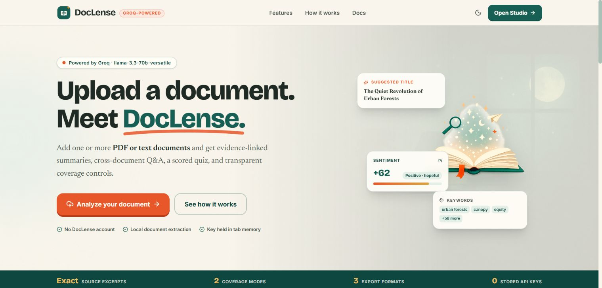
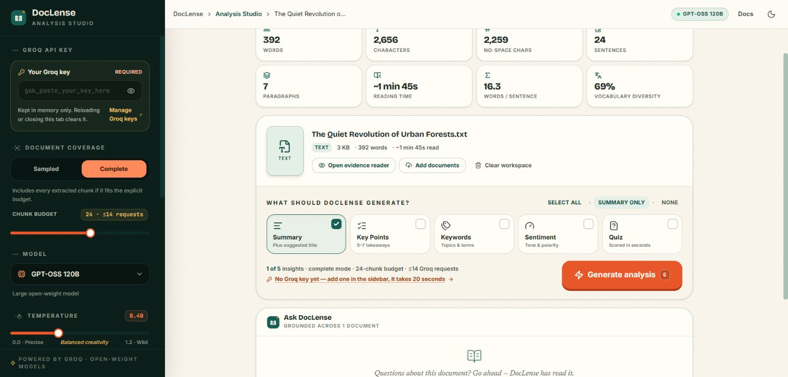
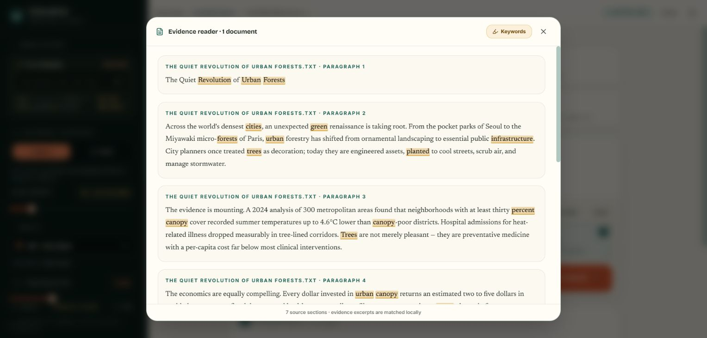
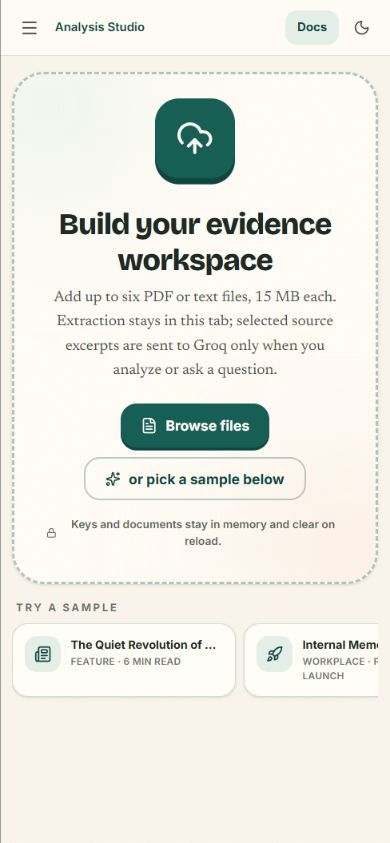
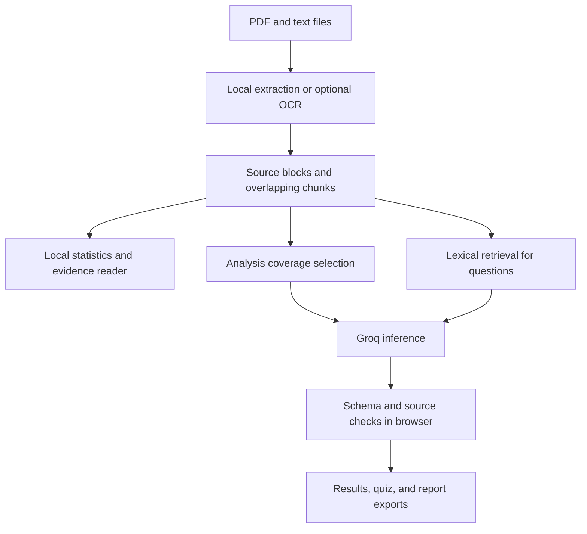

<div align="center">

# DocLense

**Document analysis with the evidence in view.**

Turn PDFs and text files into source-linked summaries, cross-document answers, and quizzes in a browser-based workspace.

[**Live demo**](https://miniproject2-peach.vercel.app/) · [**Open Studio**](https://miniproject2-peach.vercel.app/#/app) · [**User guide**](https://miniproject2-peach.vercel.app/#/docs)

</div>



[Features](#features) · [Getting started](#getting-started) · [Architecture](#architecture) · [Development](#development) · [Deployment](#deployment)

## Overview

DocLense helps students, researchers, and anyone working through documents move from reading to asking questions and checking sources. Add up to six files, choose the insights you need, and inspect the supporting page or paragraph alongside the result.

Document extraction, optional OCR, statistics, passage retrieval, and citation matching run in your browser. AI analysis and Q&A use your own Groq API key. There is no DocLense application backend or database.

> **Try it without a key:** Open the Studio and select a built-in sample to explore document statistics and the evidence reader. Generating AI results and asking questions require a personal Groq API key.

## Features

| Capability | What you can do |
| --- | --- |
| Document workspace | Add PDF, TXT, Markdown, or `.text` files; keep sources distinct across a workspace of up to six documents. |
| Selective analysis | Request a summary and suggested title, key points, keywords, sentiment, a quiz, or a combination of these outputs. |
| Source inspection | Open cited pages or paragraphs in the evidence reader, with quoted excerpts and keyword highlighting. |
| Cross-document Q&A | Ask across the workspace using local BM25-style lexical passage ranking and source-linked answers. |
| Coverage controls | Choose sampled or complete mode and set a chunk budget; inspect the reported chunk coverage. |
| Study quizzes | Choose difficulty, answer multiple-choice questions, see scores and explanations, and retake a quiz. |
| Local statistics | View word and character counts, sentences, paragraphs, vocabulary diversity, and estimated reading time at 225 words per minute. |
| Scanned documents | Opt into local English OCR for image-only PDFs, covering at most the first 10 pages. |
| Report exports | Download TXT, Markdown, or PDF reports containing generated analysis, source evidence, and statistics. |
| Adjustable workspace | Switch light/dark themes and configure the model, summary style, output language, reading level, temperature, and token limit. |

AI output is schema-validated and cited excerpts are matched against extracted source text. A matching quotation does **not** establish that a conclusion is correct: claim-support labels are heuristic, and important conclusions need source review.

### Studio preview



<details>
<summary>Evidence reader and mobile preview</summary>





</details>

*Screenshots show the deployed interface and built-in sample content. They do not depict a completed live AI request.*

## Getting started

### Prerequisites

- **Node.js 24** and npm. This satisfies the locked tooling and PDF library requirements.
- Git and a modern browser.
- A personal [Groq API key](https://console.groq.com/keys) for AI analysis and Q&A.

### Install and run

```bash
git clone https://github.com/Adii2556/miniproject2.git
cd miniproject2
npm ci
npm run dev
```

Open the local URL printed by Vite, normally `http://127.0.0.1:5173`, and enter the Studio.

**No `.env` file, database initialization, or application environment variables are required.** Paste your personal Groq key into the Studio's **Your Groq key** field when you want to generate results. Do not commit credentials to the repository.

### Analyze a document

1. Add files or select a built-in sample. Statistics appear after extraction.
2. For an image-only PDF, optionally start English OCR and review the extracted text.
3. Choose **Sampled** or **Complete** coverage and a chunk budget.
4. Select the outputs you want and click **Generate analysis**.
5. Open source evidence from a result, ask a question, or take the generated quiz.
6. Export your report as TXT, Markdown, or PDF.

On mobile, open the settings menu to enter your key and adjust analysis options. In the Studio, **G** starts generation and **D** downloads the TXT report when the relevant action is available and a text field is not focused.

### Data handling and limits

- Files are limited to **15 MB each**, with **six documents** per workspace. PDF extraction supports up to **250 pages**; extracted PDF text and plain-text inputs are capped at **1,000,000 characters per file**.
- **Sampled mode** selects chunks across documents. **Complete mode** attempts every extracted chunk within the configured budget and rejects a workspace that exceeds that budget. Coverage describes chunk selection, not factual accuracy or guaranteed retention of every detail in the final answer.
- OCR is **English-only**, limited to the **first 10 pages**, and may introduce recognition errors.
- The key, documents, results, and chat use memory rather than persistent browser storage. Reloading clears them; navigating away from the Studio can also clear its active workspace. Theme and analysis preferences may persist locally. Export anything you want to keep.
- Starting generation or Q&A sends selected source context and your request directly to Groq, authenticated with your key. Recent chat turns may also be included for Q&A. Review documents before sending them and follow the provider's applicable terms and data policies.
- Model availability, account limits, response quality, and request charges depend on Groq. The app provides no measured accuracy guarantee.

## Architecture



Short single documents can use a direct analysis request. Larger workspaces use chunk-level notes followed by synthesis. Q&A retrieves passages from the extracted workspace without an embedding service or vector database. Groq is the external AI provider; the remaining processing shown above runs in the browser.

### Technology stack

| Area | Technologies |
| --- | --- |
| Interface | React 19, React Router 7, strict TypeScript 5.9 |
| Styling and interaction | Tailwind CSS 4, Framer Motion, Lucide React |
| Document processing | PDF.js (`pdfjs-dist`), Tesseract.js with packaged English OCR data |
| AI and validation | Groq's OpenAI-compatible API, Zod 4 |
| PDF reports | jsPDF 4 |
| Build and hosting | Vite 7, static deployment on Vercel |
| Quality tools | ESLint 9, Vitest 5, Playwright, axe-core, GitHub Actions |

Exact dependency resolutions are recorded in [`package-lock.json`](package-lock.json).

### Project structure

| Path | Responsibility |
| --- | --- |
| [`src/App.tsx`](src/App.tsx) | Hash-based routing for Home, Studio, and Docs |
| [`src/pages/`](src/pages/) | Landing page, analysis workflow, and user documentation |
| [`src/components/`](src/components/) | Settings, results, quiz, citation chips, and evidence reader |
| [`src/lib/document.ts`](src/lib/document.ts) | Source models, chunking, coverage, retrieval, and citation matching |
| [`src/lib/groq.ts`](src/lib/groq.ts) | Prompts, AI requests, response validation, and orchestration |
| [`src/lib/`](src/lib/) | PDF/OCR extraction, statistics, memory history, and report exports |
| [`tests/`](tests/) | Pipeline, validation, export, and browser regression tests |
| [`scripts/`](scripts/) | Audit, regression, and engineering benchmark commands |
| [`docs/architecture.md`](docs/architecture.md) | Additional architecture documentation |
| [`vite.config.ts`](vite.config.ts) / [`vercel.json`](vercel.json) | Build, packaged OCR assets, and hosting configuration |

## Development

| Command | Purpose |
| --- | --- |
| `npm run dev` | Start the Vite development server |
| `npm run lint` | Run ESLint |
| `npm run test` | Run the Vitest suite once |
| `npm run build` | Type-check and produce `dist/` |
| `npm run preview` | Serve the production build locally |
| `npm run check` | Run lint, tests, build, and security regression checks |
| `npm run audit:prod` | Check production dependencies against npm advisories |
| `npm run test:e2e` | Run desktop and mobile Playwright projects |

Before running browser tests, install Chromium:

```bash
npx playwright install chromium
npm run test:e2e
```

On Linux, Playwright may also require system browser dependencies; use `npx playwright install --with-deps chromium` where permitted.

Browser tests mock Groq responses for deterministic workflow checks; they do not establish live model quality. Deployment-header checks are skipped unless the test-only `DEPLOYMENT_URL` variable is set. For example, in PowerShell:

```powershell
$env:DEPLOYMENT_URL = "https://miniproject2-peach.vercel.app"
npm run test:headers
```

## Deployment

The linked demo is hosted on Vercel. For your own deployment, import the repository with these settings:

| Setting | Value |
| --- | --- |
| Framework | Vite |
| Root directory | Repository root |
| Install command | `npm ci` |
| Build command | `npm run build` |
| Output directory | `dist` |
| Node.js | 24.x |

Keep `vercel.json` and the build-generated `/ocr` assets. Hash routing supplies `/#/app` and `/#/docs` without additional page rewrites. Each visitor supplies their own Groq key in the Studio; no shared provider credential is needed at deployment.

To inspect the build before deploying:

```bash
npm run build
npm run preview
```

## Contributing

For a proposed change, open an issue describing the problem or intended behavior, then submit a focused pull request. Run `npm run check`, `npm run audit:prod`, and the browser suite before submitting, and describe any checks you could not run. Use synthetic documents and placeholder credentials in examples and tests.

No license file is currently included in this repository.
